## Executive Summary

GhostAction was a GitGuardian-named GitHub supply chain campaign detected on
September 2, 2025 and disclosed on September 5, 2025. An unidentified actor
used previously compromised GitHub credentials or tokens to add malicious
GitHub Actions workflows to repositories. Those workflows serialized secrets
available to their jobs and transmitted the data to a specific `webhook.site`
URL.

GitGuardian reported 327 compromised accounts, 817 affected repositories, and
3,325 exposed or stolen secrets. These figures are vendor-reported and were not
independently audited. Public reporting does not establish the original
credential-acquisition method, a complete victim list, widespread downstream
package compromise, custom malware, or attribution to a known actor.

The strongest defensive conclusion is that GhostAction abused valid GitHub
access and trusted CI automation. It was not shown to exploit a vulnerability
in GitHub. Defenders should prioritize workflow integrity, credential rotation,
least-privilege Actions permissions, repository audit review, and investigation
of possible post-exposure use of source-control, registry, container, and cloud
credentials.

## Campaign Overview

| Attribute | Assessment |
| --- | --- |
| Campaign name | GhostAction, assigned by GitGuardian |
| Detection date | September 2, 2025 |
| Public disclosure | September 5, 2025 |
| Target surface | GitHub accounts, repositories, and GitHub Actions workflows |
| Initial access | Valid compromised GitHub credentials or tokens |
| Credential-acquisition method | Unknown |
| Primary objective | Theft of secrets available to GitHub Actions jobs |
| Exfiltration channel | HTTPS to a specific `webhook.site` endpoint |
| Actor | Unidentified |
| Malware | None documented |
| GitHub vulnerability exploited | None documented |

### Reported Scope

| Measure | Vendor-reported value | Qualification |
| --- | ---: | --- |
| Compromised GitHub accounts | 327 | Not independently audited |
| Affected repositories | 817 | Not independently audited |
| Exposed or stolen secrets | 3,325 | Not independently audited |
| GitHub tokens | 1,081 | Reported subtotal |
| npm tokens | 1,000 | Reported subtotal |
| PyPI tokens | 15 | Reported subtotal |
| AWS credentials | 10 | Reported subtotal |
| GCP credentials | 6 | Reported subtotal |
| Azure credentials | 4 | Reported subtotal |
| Docker Hub credentials | Unspecified | Presence reported without a public count |

The figures describe discovered exposure, not necessarily successful downstream
use. Public sources did not establish how many workflows executed, how many
secrets were unique and valid, or how many credentials the actor later used.

## Attack Chain

The supported sequence begins after the actor obtained valid GitHub access.
The original credential-acquisition mechanism remains unknown.

```mermaid
flowchart LR
    A[Unknown credential<br/>acquisition]:::gap
    B[Valid GitHub credentials<br/>or tokens obtained]:::access
    C[Malicious workflow added<br/>under .github/workflows]:::action
    D[Repository event triggers<br/>GitHub Actions job]:::action
    E[Job-visible secrets<br/>serialized]:::credential
    F[Secrets sent by HTTPS to<br/>specific webhook.site URL]:::exfil
    G[Vendor-reported exposure<br/>of 3,325 secrets]:::impact
    H[Possible source, package,<br/>registry, or cloud abuse]:::gap

    A -.-> B
    B --> C
    C --> D
    D --> E
    E --> F
    F --> G
    G -.-> H

    classDef access fill:#dceeff,stroke:#245a8d,color:#102a43
    classDef action fill:#fff3bf,stroke:#8a6d1d,color:#3d310d
    classDef credential fill:#f3d9fa,stroke:#862e9c,color:#3b1645
    classDef exfil fill:#ffe3e3,stroke:#9b2c2c,color:#4a1717
    classDef impact fill:#ffd8a8,stroke:#a64b00,color:#512500
    classDef gap fill:#f1f3f5,stroke:#5c6770,color:#343a40,stroke-dasharray: 5 5
```

Dotted transitions are unresolved or unconfirmed. The final downstream-abuse
node represents risk created by stolen credentials, not a publicly demonstrated
campaign phase.

### Initial Access

The actor possessed working GitHub credentials or tokens for affected accounts
and used their legitimate repository permissions. Public reporting does not
explain whether the actor obtained those credentials through phishing,
infostealer malware, token leakage, previous repository exposure, OAuth abuse,
or another method.

### Workflow Modification and Execution

Malicious YAML files were added beneath `.github/workflows/`. Repository events
then caused GitHub Actions runners to execute those workflows. The workflow
itself supplied repository and CI persistence because it could execute again
until removed. No operating-system persistence or endpoint implant was
documented.

### Secret Access and Exfiltration

The workflows reportedly used `${{ toJSON(secrets) }}` or equivalent logic to
serialize secrets available to a job. Shell or curl-style HTTPS transfer then
sent the serialized data to the reported webhook endpoint.

Secret exposure depended on the repository, workflow trigger, environment
protections, job permissions, and secret configuration. A compromised workflow
does not prove that every repository or organization secret was exposed.

### Potential Follow-on Activity

Stolen GitHub, npm, PyPI, Docker Hub, and cloud credentials create credible
risk of:

* Additional repository or organization compromise
* Malicious package or container publication
* Release or artifact tampering
* Cloud resource access or modification
* Further credential theft and lateral movement

These outcomes are plausible but were not demonstrated as widespread
GhostAction activity in the reviewed public reporting.

## Indicators of Compromise

One atomic IOC is supported by the reviewed sources.

| Type | Value | Context | Confidence | First seen |
| --- | --- | --- | --- | --- |
| URL | `https://webhook.site/bb8ca5f6-4175-45d2-b042-fc9ebb8170b7` | Credential and secret exfiltration endpoint embedded in malicious workflows | High | Not publicly available |

The parent `webhook.site` domain is a legitimate shared service. Domain-only
matching has a high false-positive risk. Detection should prioritize the exact
UUID path together with suspicious workflow changes, secret serialization, and
outbound transfer behavior. HTTPS telemetry may expose only the hostname rather
than the full path.

No evidence-supported attacker IP addresses, file hashes, malware filenames,
commit hashes, complete malicious workflow filenames, packages, or authoritative
victim repository identifiers were found.

## MITRE ATT&CK Mapping

### Tactics

| ATT&CK ID | Tactic | Confidence | Rationale |
| --- | --- | --- | --- |
| TA0001 | Initial Access | High | The actor used valid compromised GitHub credentials or tokens to access repositories |
| TA0002 | Execution | High | Repository events triggered malicious GitHub Actions workflows |
| TA0003 | Persistence | High | Malicious workflows remained rerunnable until removed |
| TA0006 | Credential Access | High | Workflows accessed and serialized job-visible secrets |
| TA0010 | Exfiltration | High | Workflows transmitted secrets to an external webhook over HTTPS |

### Techniques

| ATT&CK ID | Technique | Confidence | Evidence and limits |
| --- | --- | --- | --- |
| T1078.004 | Valid Accounts: Cloud Accounts | High | Valid compromised GitHub credentials or tokens provided authenticated repository access; their acquisition method is unknown |
| T1546 | Event Triggered Execution | Medium | Repository events triggered stored GitHub Actions workflows; ATT&CK has no GitHub Actions-specific sub-technique |
| T1567.004 | Exfiltration Over Webhook | High | Serialized secrets were sent over HTTPS to the reported `webhook.site` URL |

No additional Credential Access technique is assigned for reading the Actions
`secrets` context because the evidence does not cleanly establish Credentials
from Password Stores, Unsecured Credentials, or theft from a particular token
store. Serverless Execution is omitted because the reviewed evidence does not
identify whether affected jobs used GitHub-hosted or self-hosted runners.

## Detection and Hunting Opportunities

Detection should combine repository control-plane evidence with workflow
content and network behavior. Endpoint-oriented Microsoft Defender XDR hunting
is most relevant when GitHub Actions uses monitored self-hosted runners.
GitHub-hosted runners generally require GitHub audit, repository, workflow, or
external network telemetry.

| Priority | Opportunity | Evidence and telemetry | Tuning considerations |
| --- | --- | --- | --- |
| P0 | Detect unauthorized workflow creation or modification | Git commits, pull requests, GitHub audit logs, branch protection events, and `.github/workflows/` file changes | Baseline approved automation accounts and expected workflow maintainers |
| P0 | Find the exact exfiltration URL | Repository search, workflow history, proxy telemetry, DNS records, secure web gateway logs, and monitored runner network events | Prefer the complete URL; hostname-only matches can be noisy |
| P0 | Identify bulk secret-context serialization | Workflow YAML containing `toJSON(secrets)` or equivalent interpolation and encoding logic | Validate legitimate debugging or administrative workflows before escalation |
| P1 | Correlate secret serialization with outbound HTTP transfer | Workflow steps, runner process telemetry, command lines, and network connections | Require temporal correlation and distinguish approved webhook integrations |
| P1 | Detect suspicious use of exposed credentials | GitHub, npm, PyPI, Docker Hub, AWS, GCP, and Azure audit records | Start from each credential's exposure window, scope, and normal usage pattern |
| P1 | Find repository security-control weakening | Branch protection, CODEOWNERS, workflow approval, environment protection, webhook, deploy-key, GitHub App, and token changes | Review actor identity, source, timing, and change justification |
| P2 | Revalidate artifacts from the exposure window | Build attestations, package versions, container digests, releases, and deployment records | Prioritize externally distributed or privileged artifacts |

Locally available Defender XDR schema context confirmed relevant
`DeviceNetworkEvents` fields including `Timestamp`, `DeviceId`, `DeviceName`,
`ActionType`, `RemoteUrl`, `RemotePort`, `InitiatingProcessFileName`, and
`InitiatingProcessCommandLine`. No KQL is included because a live workspace was
not queried and full URL-path visibility cannot be assumed.

## Containment and Remediation

1. Remove unauthorized workflows and inspect their full commit history.
2. Revoke compromised GitHub sessions, personal access tokens, deploy keys,
   OAuth grants, GitHub Apps, and SSH keys.
3. Rotate every repository, organization, environment, package-registry,
   container-registry, and cloud secret potentially exposed to affected jobs.
4. Review GitHub organization audit logs for unusual workflow changes, token
   creation, repository access, branch-protection changes, releases, webhooks,
   deploy keys, and application authorizations.
5. Inspect npm, PyPI, container registry, GitHub release, AWS, GCP, and Azure
   audit records for post-exposure use.
6. Reduce default `GITHUB_TOKEN` permissions and apply least privilege to
   Actions secrets and environments.
7. Require review for workflow-file changes and protect `.github/workflows/`
   with CODEOWNERS or equivalent controls.
8. Prevent untrusted pull requests and forks from receiving privileged secrets.
9. Rebuild or revalidate artifacts produced during the suspected compromise
   window.
10. Preserve malicious workflow content and relevant audit records before
    cleanup when incident-response requirements permit.

Broad blocking of `webhook.site` may disrupt legitimate developer activity.
Prioritize the exact path and behavior unless organizational policy prohibits
shared webhook services.

## Attribution Assessment

No reputable reviewed source attributes GhostAction to a known group, country,
government, or malware family. Actor identity, motivation, and infrastructure
beyond the reported webhook remain unknown.

Public evidence does not support linking GhostAction to Nx/s1ngularity,
Shai-Hulud, `tj-actions/changed-files`, or other 2025 supply chain incidents.
Shared focus on open-source ecosystems or CI/CD infrastructure is not sufficient
for campaign linkage.

## Sources

| Source | Publication or access date | Contribution |
| --- | --- | --- |
| [GitGuardian: GhostAction campaign, 3,325 secrets stolen](https://blog.gitguardian.com/ghostaction-campaign-3-325-secrets-stolen/) | Published 2025-09-05; accessed 2026-10-14 | Primary campaign telemetry, technique, scope, and IOC |
| [BleepingComputer: GhostAction attack steals 3,325 secrets](https://www.bleepingcomputer.com/news/security/ghostaction-attack-steals-3-325-secrets-from-github-repositories/) | Published 2025-09-05; accessed 2026-10-14 | Contemporary secondary reporting |
| [The Hacker News: GhostAction compromises 327 GitHub accounts](https://thehackernews.com/2025/09/ghostaction-campaign-compromises-327.html) | Published September 2025; accessed 2026-10-14 | Contemporary secondary reporting |
| [SecurityWeek: GhostAction compromised hundreds of GitHub accounts](https://www.securityweek.com/ghostaction-campaign-compromised-hundreds-of-github-accounts/) | Published September 2025; accessed 2026-10-14 | Contemporary secondary reporting |
| [GitHub contexts reference](https://docs.github.com/en/actions/reference/accessing-contextual-information-about-workflow-runs) | Accessed 2026-10-14 | GitHub Actions context semantics |
| [GitHub: Using secrets in GitHub Actions](https://docs.github.com/en/actions/security-for-github-actions/security-guides/using-secrets-in-github-actions) | Accessed 2026-10-14 | Secret behavior and defensive configuration |
| [GitHub: Security hardening for GitHub Actions](https://docs.github.com/en/actions/security-for-github-actions/security-guides/security-hardening-for-github-actions) | Accessed 2026-10-14 | Workflow hardening guidance |
| [GitHub: Automatic token authentication](https://docs.github.com/en/actions/security-for-github-actions/security-guides/automatic-token-authentication) | Accessed 2026-10-14 | `GITHUB_TOKEN` permissions guidance |
| [GitHub: Reviewing the audit log for an organization](https://docs.github.com/en/organizations/keeping-your-organization-secure/managing-security-settings-for-your-organization/reviewing-the-audit-log-for-your-organization) | Accessed 2026-10-14 | Audit investigation guidance |
| [MITRE ATT&CK T1078.004](https://attack.mitre.org/techniques/T1078/004/) | Accessed 2026-10-14 | Valid Accounts: Cloud Accounts |
| [MITRE ATT&CK T1546](https://attack.mitre.org/techniques/T1546/) | Accessed 2026-10-14 | Event Triggered Execution |
| [MITRE ATT&CK T1567.004](https://attack.mitre.org/techniques/T1567/004/) | Accessed 2026-10-14 | Exfiltration Over Webhook |