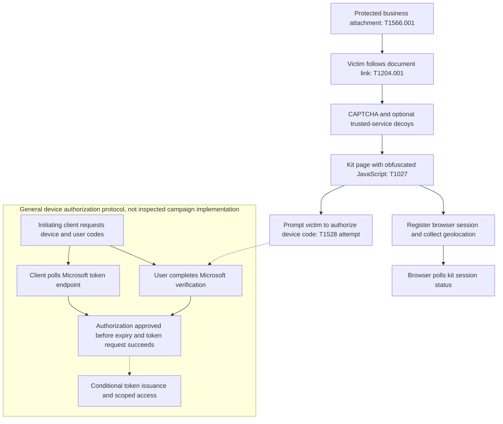

## Executive summary

SkyW4lker, also branded SkyW4lker x365 Sentinel, is a Microsoft 365 device-code phishing kit analyzed by ANY.RUN. Its reported workflow uses password-protected business documents, intermediary pages, and instructions to authorize an attacker-associated device code on legitimate Microsoft authentication pages. The Hacker News article summarizes the original ANY.RUN investigation; it is not independent corroboration.

The attack abuses authorization context: a genuine Microsoft login page and successful multifactor authentication do not establish that the initiating client is trustworthy. Under the device authorization protocol, successful authorization can issue tokens to that client, subject to scopes, application permissions, policy, and token validity. Actual campaign token issuance, replay, and downstream compromise were not independently verified.

## Reported attack chain

1. Phishing emails deliver password-protected PDF, DOCX, or XLSX business lures, including invoice, contract, and proposal themes; the password is supplied in the message.
2. Embedded document links lead through CAPTCHA and optional trusted-service decoys to a phishing page. The aggregate description does not establish one universal ordering for intermediary pages.
3. The page uses obfuscated JavaScript and a PHP backend. Reported modules include visitor IP/geolocation collection and session registration.
4. A browser request to `/assets/php/endpoints/session_public.php?action=start` registers a session; repeated `action=poll` requests monitor its status. These browser-to-kit requests are distinct from Microsoft token-endpoint polling.
5. The lure instructs the recipient to enter a device code at a legitimate Microsoft verification page. In the general protocol, the initiating client obtains codes and polls Microsoft; successful user authorization before expiry can allow token issuance. Campaign client IDs, requested scopes, and successful token responses remain unknown.

Solid edges represent source-described behavior or documented protocol dependencies. Dashed edges are conditional. Browser session polling and the authorization prompt can run concurrently. The timing of Microsoft code issuance relative to kit session setup is unknown. Mermaid source is included for reuse; rendering and parser validation were not performed.

## Infrastructure and indicators

These are curated, defanged indicators reported by ANY.RUN, not a complete campaign feed. The source references 173 domains; that full feed was not reproduced. Ownership, current maliciousness, and actor-owned versus compromised status were not independently established.

| Indicator                    | Reported path                    | Observation date             | Qualification                                      |
|------------------------------|----------------------------------|------------------------------|----------------------------------------------------|
| `5200m[.]com`                 | `/kvme2/`                        | 2026-10-16                   | Also reported for Gabagool on 2026-10-15            |
| `torvion[.]life`              | `/ofulium/`                      | 2026-10-05                   | Also reported for Gabagool on 2026-10-06            |
| `ghethim[.]com`               | `/hyllen/`                       | 2026-09-28 through 2026-10-02 | Also reported for Gabagool on 2026-10-08            |
| `goldcreekconcrete[.]org`     | `/skyw4lker/skydirectory/`        | 2026-09-29                   | Also associated with Gabagool                      |
| `0ff365access.mooo[.]com`     | Not supplied                     | Not supplied                 | Match the full hostname, not shared parent domain  |

Relative paths such as `/assets/js/client_geo.js`, `/assets/js/endpoint.js`, and `/assets/js/url_helper.js` are supporting artifacts, not standalone attributable IOCs. Do not fabricate schemes or complete URLs from domain/path fragments.

ANY.RUN also reports the attachment SHA-256 `9aa0b87974b9b4cd42603833b7ad44257578467d279b315a071108a5ed02c268`. Its 64-character hexadecimal format was checked locally; the sample was not downloaded and the hash was not independently recomputed. File type remains uncertain.

Microsoft authentication domains, Google Sites, and public geolocation services are legitimate services that may be abused. Do not block them wholesale. Match exact reported hosts and paths with message, browser, and identity context.

## Attribution assessment

ANY.RUN assesses shared development with Gabagool based on modules, formats, and hosting overlap. That supports a development relationship hypothesis, not a confirmed common operator.

Password-related module fields do not establish password theft in SkyW4lker's device-code flow. ANY.RUN distinguishes Gabagool's `accounts.php` credential harvesting from SkyW4lker's `session_public.php` device-code mode.

No reviewed campaign evidence establishes a link to Storm-2372 or Midnight Blizzard. Microsoft's separate Storm-2372 reporting provides context for device-code phishing, not attribution or proof of shared downstream techniques.

## MITRE ATT&CK mapping

Official technique references were retrieved during research. Mapping reflects reported procedures, not demonstrated success or measured coverage.

| Technique | Name                              | Evidence and confidence                                                   |
|-----------|-----------------------------------|---------------------------------------------------------------------------|
| T1566.001 | Spearphishing Attachment           | High: protected business documents delivered by phishing email             |
| T1204.001 | Malicious Link                    | High for lure behavior: recipient follows document-embedded links          |
| T1027     | Obfuscated Files or Information   | High: reported JavaScript obfuscation; effectiveness not measured          |
| T1528     | Steal Application Access Token    | Strong mechanism fit: device-code token-acquisition attempt; theft unproven |

Relevant tactics are Initial Access, Execution (victim link interaction, not proven endpoint payload execution), Defense Evasion, and Credential Access.

Do not infer spearphishing-link email delivery solely from an attachment's embedded link, sandbox detection solely from CAPTCHA, or network reconnaissance solely from visitor geolocation. Token replay, mailbox collection, Graph exfiltration, lateral phishing, device registration, broker-client abuse, and persistence are not established campaign phases.

## Defensive recommendations

* Audit legitimate device-code usage and restrict unnecessary device-code authentication with Conditional Access. Test in report-only mode before enforcement; retain documented, secured exceptions and audited emergency-access exclusions. No policy was deployed here.
* Teach users that invoices and shared documents should not require entering externally supplied device codes. Verify the requesting application and authorization context rather than trusting the Microsoft URL alone. Retain MFA.
* Inspect protected attachments through approved procedures, preserve extracted links and redirect chains, and correlate email delivery with browser and identity activity.
* If unauthorized authorization is suspected, preserve evidence and follow approved account, session, and refresh-token revocation procedures. Verify containment in the affected resources; do not assume every access token immediately becomes unusable.
* Investigate suspicious mailbox or cloud-document access, rules, consents, and outbound messages as possible follow-on compromise, not as already observed SkyW4lker behavior.

## Detection opportunities

| Opportunity                                       | Required telemetry                                  | Important limits                                              |
|---------------------------------------------------|-----------------------------------------------------|---------------------------------------------------------------|
| Protected attachment followed by document clicking | Mail, attachment metadata, extracted URLs, clicks    | Legitimate protected documents create false positives         |
| Exact reported hostname and path                  | Historical mail, browser, proxy, or gateway records  | Infrastructure overlap and changing ownership require context |
| Session start followed by repeated kit polling    | HTTP paths, query strings, related script requests   | HTTPS hostname-only telemetry cannot establish this sequence  |
| Unexpected device-code sign-in after lure activity | Entra authentication-flow evidence plus mail/browser | Legitimate tooling; victim and client IPs can differ           |
| Unfamiliar application/resource use afterward      | Identity and Microsoft 365 resource audit records    | General investigation hypothesis, not observed exfiltration   |

These are analytic opportunities, not validated detections. Connector coverage, retention, schemas, field semantics, and application baselines must be established before authoring KQL. No queries were executed, and no detection-coverage claim is made.

## Sources

* [ANY.RUN primary investigation](https://any.run/cybersecurity-blog/skyw4lker-phishing-kit-analysis/)
* [The Hacker News campaign summary](https://thehackernews.com/2026/10/american-organizations-under-attack.html)
* [Microsoft device authorization protocol](https://learn.microsoft.com/en-us/entra/identity-platform/v2-oauth2-device-code)
* [Conditional Access authentication-flow controls](https://learn.microsoft.com/en-us/entra/identity/conditional-access/policy-block-authentication-flows)
* [Microsoft's separate Storm-2372 reporting](https://www.microsoft.com/en-us/security/blog/2025/02/13/storm-2372-conducts-device-code-phishing-campaign/)
* [ANY.RUN publication metadata](https://any.run/cybersecurity-blog/wp-json/wp/v2/posts/24071?_fields=date,date_gmt,modified,modified_gmt,link,title)
* [MITRE T1566.001](https://attack.mitre.org/techniques/T1566/001/)
* [MITRE T1204.001](https://attack.mitre.org/techniques/T1204/001/)
* [MITRE T1027](https://attack.mitre.org/techniques/T1027/)
* [MITRE T1528](https://attack.mitre.org/techniques/T1528/)
