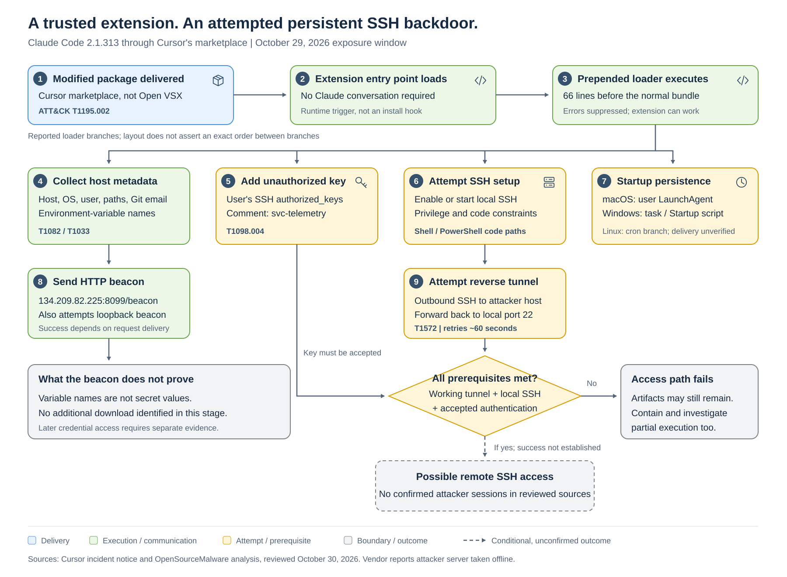

## The extension worked, and so did the malicious loader

A developer extension does not need to look broken to be dangerous. In this
incident, malicious JavaScript ran ahead of the legitimate Claude Code extension
bundle while leaving the expected developer experience largely intact.

The modified package attempted to plant an SSH authentication key, enable an SSH
server, create a reverse tunnel, and preserve that access through operating-system
startup mechanisms. It also collected host information and transmitted it to an
attacker endpoint. Starting a Claude conversation was not required: loading the
extension's JavaScript entry point was sufficient to trigger the injected stage.

But the distinction between an attempted backdoor and a functioning one matters.
Cursor says errors in the malicious code meant the remote-access setup would
fail outside highly unusual circumstances involving administrator privileges.
That limitation does not make an executed malicious extension safe: unauthorized
keys, persistence artifacts, and host-information disclosure still require
investigation.

> [!IMPORTANT]
> The affected distribution channel was Cursor's VS Code extension marketplace,
> not Open VSX. OpenSourceMalware corrected its initial account after contact
> with Cursor. The supplied Cyber Security News article retains the earlier
> Open VSX attribution. Cursor says the malicious package was not developed by
> Anthropic and reports no evidence that other versions or the official
> distribution were affected.

## What is established, and what remains unknown

The identified package was `anthropic.claude-code`, version `2.1.313`.
Cursor places its availability between approximately 2:27 a.m. and 1:35 p.m.
Pacific Time on October 29, 2026, and reports at most 5,000 affected users. That
number must not be presented as 5,000 confirmed successful SSH compromises.

Cursor reports removing the package, temporarily shutting down the marketplace,
auditing access, rotating keys, rebuilding the marketplace, and restoring service.
It also says it worked with the hosting provider to take the attacker server
offline. Its public announcement asks customers to update to version `2.1.314`.
These are vendor-reported response actions, not independently tested outcomes.

OpenSourceMalware describes a 66-line loader prepended to the normal
`extension.js` bundle. Its analysis focuses on a macOS Apple Silicon artifact
and identifies Linux and Windows branches. Cursor separately publishes hashes
for malicious macOS Apple Silicon and Windows x64 VSIX packages. Linux code in
the loader is evidence of implemented capability, not proof of Linux delivery
or successful Linux infections.

The public sources reviewed do not establish the attacker's identity, the precise
marketplace intrusion mechanism, a complete victim inventory, or the extent of
any follow-on activity. They do not establish a model vulnerability, a Claude
service compromise, or a CVE for this incident.

## How the backdoor was designed to work

The chain crossed several trust boundaries: extension distribution, local code
execution, SSH authentication, outbound connectivity, and recurring execution.
Each stage had a different prerequisite.



The branches show reported loader behavior, not an exact execution order.
Successful remote login requires a working tunnel, a reachable local SSH
service, and accepted authentication. The dashed path is conditional:
successful attacker sessions are not established by the reviewed sources.
An [editable SVG version](./claude-code-extension-attack-flow.svg) is
available for publication.

### Execution happened at extension runtime

The injected loader was an immediately invoked JavaScript function at the start
of `extension.js`. It imported Node.js facilities for command execution,
filesystem access, operating-system information, HTTP requests, and cryptographic
operations. The legitimate extension bundle followed it.

This was not a package-installation-hook attack. OpenSourceMalware reports no
install, prepare, preinstall, or postinstall scripts in the analyzed package.
The relevant trigger was extension activation and module loading.

Exception suppression helped the loader remain unobtrusive. A failed
service-start operation could leave the extension usable while other malicious
steps continued. An apparently functioning assistant was therefore not evidence
that the package was trustworthy.

### One SSH key allowed login; another authenticated the tunnel

The loader appended an attacker-controlled Ed25519 public key to the user's
`authorized_keys`, using the comment `svc-telemetry`. It applied permissions
consistent with ordinary Unix SSH configurations: `0700` for the SSH directory
and `0600` for the authorized-keys file.

The public-key fingerprint was:

```text
SHA256:0Z6R+DF64Do2nwQic8a7kkfDLNNk4IiK+2U2Rci4htk
```

A separate, embedded private key authenticated the outbound tunnel connection
to the attacker server. The two keys served different purposes:

* The added public key authorized inbound authentication to the victim account.
* The embedded private key authenticated the victim's outbound SSH connection
  to the tunnel server.

Recovering the tunnel key is not equivalent to recovering the attacker's
victim-login private key. Defenders should preserve the distinction when
comparing fingerprints and file hashes.

### Remote access depended on more than a planted key

The loader attempted to enable macOS Remote Login, start an SSH service on Linux,
or install and start OpenSSH Server through PowerShell on Windows. These
operations depended on permissions and platform configuration.

The reverse tunnel was designed to connect to `134.209.82.225` over SSH and
forward a remotely allocated port to the victim's local port 22. This reversed
the direction of connection establishment: the developer endpoint initiated the
network connection rather than waiting for an unsolicited inbound connection.

The loader disabled SSH host-key verification and retried connections roughly
every 60 seconds. On Unix-like systems it preferred `autossh`, falling back to
`ssh`. Whether a remotely allocated port was exposed beyond the tunnel server
depended on that server's SSH configuration.

The intended result was a path to the victim's SSH server, not proof that such
a path worked everywhere. Cursor explicitly cautions that the backdoor setup
generally failed without unusual elevated execution conditions. Existing SSH
configuration, authentication policy, code errors, and network controls also
matter.

### Persistence outlived the editor extension

On macOS, the loader wrote hidden scripts and key material under the user's
configuration directory and created a user LaunchAgent named
`com.apple.sysmond.plist`. Its `RunAtLoad` and `KeepAlive` settings were intended
to start and maintain the tunnel. The Apple-like name did not make it an Apple
component.

The Linux branch used an `@reboot` crontab entry. The Windows branch attempted
to create a startup scheduled task named `SysMon` running as `SYSTEM`, with a
Startup-folder script as a fallback. These were attempts, not evidence that
the code successfully obtained SYSTEM privileges. The task name is also not
proof that Microsoft Sysmon was installed or involved.

The practical consequence is straightforward: uninstalling the extension does
not remove an unauthorized SSH key or every standalone startup artifact.

### The initial beacon exposed metadata, not environment-variable values

The reported collection included hostname, username, operating system,
architecture, home and working directories, configured Git email, and public IP.
The loader also selected the names of up to 40 environment variables matching
terms such as `KEY`, `TOKEN`, `SECRET`, `PASS`, `AWS`, or `GCP`.

OpenSourceMalware says those environment-variable values were not directly
included in the initial beacon. This supports a narrower finding of metadata
collection, not a confirmed bulk theft of cloud tokens. Successful follow-on
access could expose more, but that is a risk requiring investigation rather
than an observed outcome.

The loader sent HTTP beacons to the attacker endpoint on port 8099 and to a
loopback endpoint. The loopback destination is not another external attacker
server. Public-IP lookups used legitimate services.

No additional executable or script download was identified in the injected
stage, and the beacon response was discarded rather than executed. The startup
scripts and tunnel keys were already embedded or generated locally. A
functioning remote-access channel could still support later operator activity
outside the analyzed loader.

## Why developer systems are high-value targets

The immediate target was a developer workstation, not an AI model.
Such workstations can hold source code, repository sessions, signing access,
cloud credentials, and connections to internal development services. The
actual exposure depends on the affected user's permissions and local environment.

This creates an escalation in trust rather than a demonstrated privilege
escalation exploit: an extension accepted as part of normal development
attempted to establish access outside the editor's lifecycle.

The incident also illustrates why a publisher name is insufficient as a trust
signal. Package identity, version, platform build, distribution source, and
artifact integrity must be evaluated together. A hash for the modified
JavaScript file cannot substitute for a VSIX archive hash.

There is no scenario-specific evidence here for prompt injection, model
poisoning, jailbreaks, or malicious AI-generated instructions. MITRE ATT&CK
is the appropriate primary framework; attaching ATLAS techniques solely because
the compromised product is an AI coding assistant would overstate the evidence.

## Indicators defenders can use

The following indicators are published by Cursor or OpenSourceMalware. They are
source-reported, not independently derived from a sample in this research.
Historical matches should be investigated even though Cursor reports the
attacker server has been taken offline. Shared infrastructure and later IP
reassignment can affect the interpretation of future matches.

### Package and network pivots

| Indicator                                            | Context and interpretation                                                                 |
|------------------------------------------------------|--------------------------------------------------------------------------------------------|
| `anthropic.claude-code@2.1.313`                        | Identified malicious package in the affected Cursor distribution; identity alone is weak     |
| `134.209.82.225`                                      | Attacker endpoint reported for SSH and HTTP; investigate historical connections              |
| `134.209.82.225:22`                                   | Reported outbound SSH tunnel destination                                                    |
| `http://134.209.82.225:8099/beacon`                    | Reported external HTTP POST destination                                                     |
| `http://127.0.0.1:8099/beacon`                         | Local loopback beacon attempt, not an external network-blocking indicator                    |
| `svc-telemetry`                                      | Unauthorized SSH-key comment; compare actual key material or fingerprint where available     |
| `SHA256:0Z6R+DF64Do2nwQic8a7kkfDLNNk4IiK+2U2Rci4htk` | Fingerprint of the unauthorized victim-login public key                                     |
| `SHA256:KOAU57+ZG6u3MG4WwzPzPX2O5YEe9qdOC1Bl+6MVyDQ` | Fingerprint of the separate reverse-tunnel key                                               |

`ifconfig.me` and `api.ipify.org` are legitimate public-IP services, not
attacker-owned infrastructure. Their use alone does not establish compromise.
The localhost beacon is similarly a contextual host-investigation pivot,
not evidence of an additional remote controller.

### Artifact hashes

| Object                                  | SHA-256                                                            |
|-----------------------------------------|--------------------------------------------------------------------|
| Modified VSIX, macOS Apple Silicon       | `432ccdee3801f99e52b8fe31f69ea9870118e96ea7ef9ecabed1479621b5ab62` |
| Modified VSIX, Windows x64               | `3de1722901165769893bef57c72594e9a54459faa23f3091b136b79966edd081` |
| Analyzed malicious `extension.js`        | `ecb58cb29078d9646ad1dcdbe51526f2d9cfea06be5fb2ab183e8ecc3ab6bf15` |
| Decoded embedded tunnel private-key file | `7e0a52885fadee05544a9e99eb18c792bec05900a5e1a66d68f8383decb0e278` |

OpenSourceMalware also publishes an aggregate directory digest. It is omitted
from the file-hash list because an aggregate digest is not a normal single-file
IOC and the reviewed article does not provide enough detail to reproduce its
calculation confidently.

### Persistence artifacts

| Platform   | Reported artifacts                                                                                       | Interpretation                                        |
|------------|----------------------------------------------------------------------------------------------------------|-------------------------------------------------------|
| macOS      | `~/.ssh/authorized_keys`, `~/.config/.smt`, `~/.config/.smtk`                                            | Inspect unauthorized key and tunnel script contents   |
| macOS      | `~/Library/LaunchAgents/com.apple.sysmond.plist`                                                         | Deceptively named user LaunchAgent                    |
| Linux      | `~/.config/.smt`, `~/.config/.smtk`, user crontab `@reboot` entry                                        | Implemented branch; delivery not established here     |
| Windows    | `%USERPROFILE%\.ssh\authorized_keys`, `%USERPROFILE%\.config\smt.cmd`, `%USERPROFILE%\.config\smtk`      | Key and standalone tunnel artifacts                   |
| Windows    | Scheduled task `SysMon`                                                                                  | Attempted SYSTEM task; inspect action and principal   |
| Windows    | `%APPDATA%\Microsoft\Windows\Start Menu\Programs\Startup\sysmon.cmd`                                     | Startup fallback artifact                             |
| Multiple   | Temporary `.stk_<10 hex>` file under the platform's temporary directory                                  | Decoded tunnel identity; preserve for comparison      |

Generic filenames and task names require content and process correlation.
Neither every `authorized_keys` file nor every `ssh` process is malicious.

## Detection opportunities beyond a single IP

The strongest signal is a correlated sequence: an editor extension executes,
an SSH authorization or persistence artifact appears, and an SSH client opens
an unusual reverse tunnel.

These are hunting hypotheses, not production-ready or executed analytics.
No KQL or Sigma rules were run or validated for this report.

### Reconstruct extension activation and child processes

Review editor and extension-host process trees for shell or PowerShell activity
that installs OpenSSH, enables Remote Login, creates the named task, or starts
`ssh` or `autossh`. Correlate with extension installation or update history.

Inspect the full command line rather than matching `ssh` alone. Reverse
forwarding to local port 22, disabled host-key checks, unusual identity-file
paths, and the reported destination provide stronger context together.
Equivalent quoting or argument ordering may prevent exact-string matches.

### Look for unauthorized key and startup changes

Inspect the key's actual fingerprint, not only its editable comment. Review
each relevant user's SSH authorization configuration and persistence artifacts.
On Windows, Cursor also recommends checking the administrators' authorized-keys
file when applicable to the host's OpenSSH configuration.

Correlate file creation, task registration, LaunchAgent loading, and crontab
changes with the activation timeline. A missing key today does not rule out
earlier execution, partial execution, or subsequent cleanup.

### Use network evidence to separate stages

Search historical endpoint and network records for the reported IP and ports.
An HTTP beacon supports a host-information transmission finding if the request
succeeded. An outbound SSH connection supports a tunnel attempt; it does not
alone prove that the local SSH server accepted an attacker login.

Investigate authentication and session records for successful access, then
correlate subsequent processes, file access, and outbound transfers. That
evidence is necessary before claiming interactive compromise, credential theft,
or source-code exfiltration.

## Evidence-grounded MITRE ATT&CK mapping

Confidence below describes the fit between reported behavior and the technique,
not proof that the behavior succeeded on an affected endpoint. Technique IDs
and definitions were checked against the linked MITRE pages.

| Tactic                    | Technique                                                                                                                 | Reported behavior and boundary                                         | Confidence   |
|---------------------------|---------------------------------------------------------------------------------------------------------------------------|------------------------------------------------------------------------|--------------|
| Initial Access            | [T1195.002: Compromise Software Supply Chain](https://attack.mitre.org/techniques/T1195/002/)                             | Modified extension distributed through Cursor; intrusion route unknown | High         |
| Execution                 | [T1059.004: Unix Shell](https://attack.mitre.org/techniques/T1059/004/)                                                   | Unix commands and persistence scripts in the loader                    | High         |
| Execution                 | [T1059.001: PowerShell](https://attack.mitre.org/techniques/T1059/001/)                                                   | Windows OpenSSH setup commands; successful setup not established       | High         |
| Persistence               | [T1098.004: SSH Authorized Keys](https://attack.mitre.org/techniques/T1098/004/)                                          | Adds unauthorized SSH key; login depends on service and configuration  | High         |
| Persistence               | [T1543.001: Launch Agent](https://attack.mitre.org/techniques/T1543/001/)                                                 | macOS user LaunchAgent with recurring execution settings               | High         |
| Persistence               | [T1053.003: Cron](https://attack.mitre.org/techniques/T1053/003/)                                                         | Linux `@reboot` branch; deployment not established                     | High         |
| Persistence               | [T1053.005: Scheduled Task](https://attack.mitre.org/techniques/T1053/005/)                                               | Windows task creation attempt; SYSTEM execution not proven             | High         |
| Persistence               | [T1547.001: Registry Run Keys / Startup Folder](https://attack.mitre.org/techniques/T1547/001/)                           | Windows Startup-folder fallback, not a reported registry change        | High         |
| Discovery                 | [T1082: System Information Discovery](https://attack.mitre.org/techniques/T1082/)                                         | Collects hostname, OS, and architecture                                | High         |
| Discovery                 | [T1033: System Owner/User Discovery](https://attack.mitre.org/techniques/T1033/)                                          | Collects local username and configured Git identity                    | High         |
| Command and Control       | [T1572: Protocol Tunneling](https://attack.mitre.org/techniques/T1572/)                                                   | Reverse SSH forwarding intended to expose the local SSH service        | High         |

No lateral-movement, credential-dumping, or source-code-exfiltration technique
is asserted without evidence of those actions. The SYSTEM task attempt is not
treated as confirmed privilege escalation.

## Response priorities for potentially affected teams

### Establish exposure before assuming full compromise

Inventory the extension identifier, version, platform, distribution source, and
installation or update time. Compare retained VSIX archives with the appropriate
platform hash. Where possible, inspect the installed JavaScript and correlate
with extension-host execution.

Keep three states separate:

1. The affected package was downloaded or installed.
2. The malicious entry point executed and produced observable effects.
3. An attacker successfully authenticated or performed follow-on activity.

The evidence needed to establish each state is different. Absence of the
`svc-telemetry` marker alone is not a complete negative assessment.

### Contain and preserve before removing artifacts

Isolate hosts showing payload execution or backdoor installation. Preserve
extension files, SSH authorization data, startup scripts, task or LaunchAgent
definitions, process command lines, and relevant authentication and network
logs before removal.

Apply appropriate controls for the reported endpoint and unauthorized outbound
SSH. Cursor's infrastructure takedown reduces the known server's utility; it
does not undo host modifications or establish that no access occurred earlier.

### Remediate every persistence surface

Remove the malicious extension, unauthorized key, tunnel processes, and
identified persistence mechanisms after evidence collection. Review the
[vendor's current remediation guidance and scripts](https://cursor.com/blog/claude-code-extension-security-notice) before using them;
the scripts were not executed or independently assessed in this research.

Update through a trusted channel. Cursor's public announcement recommends
version `2.1.314`, but updating alone is not a substitute for host remediation.
Do not delete legitimate SSH keys or disable an approved SSH service without
reviewing operational dependencies.

### Restore account and workstation trust

Rotate credentials and revoke relevant sessions accessible from affected
systems, using a known-clean device. Prioritize repository, cloud, CI/CD, and
signing access according to actual account exposure.

Assess whether a rebuild is needed, especially when successful remote access
cannot be excluded or telemetry is incomplete. Finding and deleting the known
files is not equivalent to establishing that the workstation is trustworthy.

## The larger lesson

This incident was not an AI model escaping its boundaries. It was conventional
malicious code entering through a trusted development workflow.

The loader attempted to convert extension execution into a durable SSH access
path while preserving the normal appearance of the tool. Its reliability limits
are important, but so is its design: unauthorized authentication material and
startup scripts can remain after an extension is removed.

The defensive lesson is to verify the distribution channel and artifact, correlate
execution with host and network changes, and distinguish attempted access from
confirmed compromise. Trust in an assistant's name cannot replace trust in the
code that runs beside it.

## Sources

1. [Cursor: Claude Code extension security notice](https://cursor.com/blog/claude-code-extension-security-notice). Primary source for the
   affected channel, October 29 exposure window, user-count ceiling, execution
   limitations, response actions, package hashes, and remediation guidance.
2. [OpenSourceMalware: Trojanized Claude Code Extension Plants an SSH Backdoor](https://opensourcemalware.com/blog/trojanized-claude-code-extension-plants-persistent-ssh-backdoor).
   Technical analysis with an updated Cursor attribution. Its introductory
   correction supersedes the older provenance caveats still present later in
   the article. The page carries an October 30 timestamp and describes October 29
   distribution.
3. [Cyber Security News: Weaponized Claude Code Extension Gives Hackers Persistent
   Remote Access to Developer Systems](https://cybersecuritynews.com/malicious-claude-code-extension/). User-supplied starting article; its
   Open VSX attribution conflicts with the later primary-source correction.
4. [Cursor's public incident announcement](https://x.com/cursor_ai/status/2116074289053175808). Vendor statement recommending
   version `2.1.314` and describing its marketplace response.
5. MITRE ATT&CK technique pages linked in the mapping table. Authoritative
   references for technique definitions, not independent evidence of this
   incident's execution or impact.
